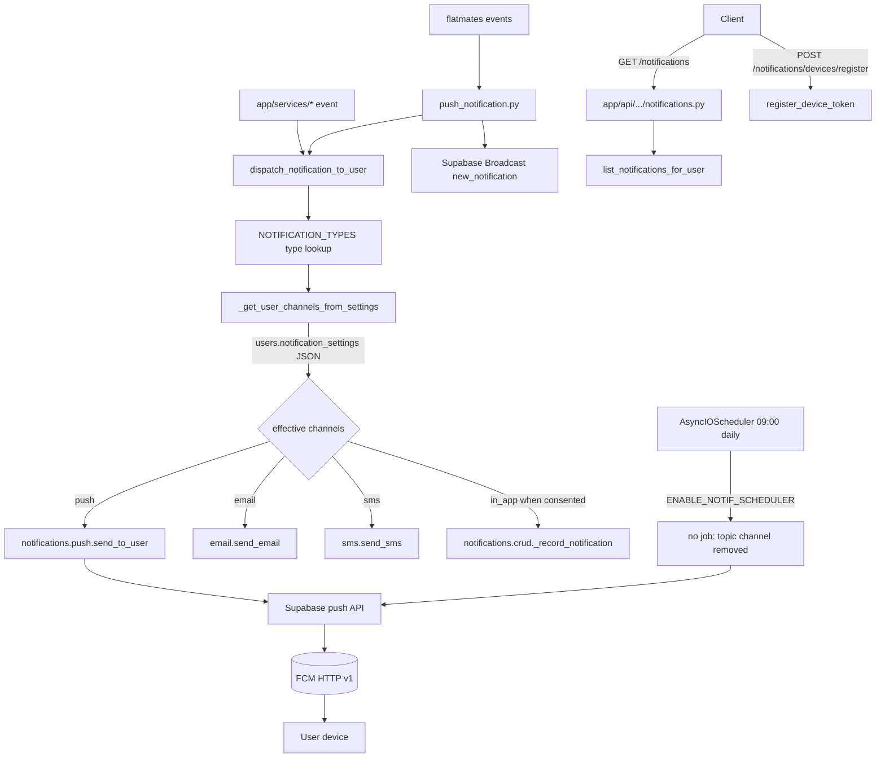

# Notifications

Active contributors: Saksham, Ravi

The notifications system is a multi-channel dispatch pipeline that delivers push (FCM), email, SMS, and in-app notifications. A central type registry in `notification_config.py` declares every notification type with its category, priority, allowed channels, TTL, and frequency cap; the dispatcher computes the effective channel set per user based on their `notification_settings` JSON; and a shared APScheduler job fires daily marketing pushes.

## Directory layout

```
app/services/
├── notification_config.py         # NOTIFICATION_TYPES registry + config dataclasses
├── notification_dispatcher.py     # dispatch_notification_to_user + segment dispatch
├── notification_scheduler.py      # daily marketing push cron registration
├── push_notification.py           # flatmates-specific push helpers
├── email.py                       # send_email (SMTP/transactional provider)
├── sms.py                         # send_sms (SMS gateway)
└── notifications/
    ├── __init__.py                # re-exports crud, fcm, helpers, push
    ├── crud.py                    # _record_notification, list_notifications_for_user, mark_opened
    ├── fcm.py                     # FCM access token, build_message, send_message
    ├── helpers.py                 # _NOTIFICATION_EXECUTOR thread pool, _supa client, _augment_data_with_meta
    └── push.py                    # register/unregister_device_token, send_to_user, send_to_token
app/api/api_v1/endpoints/
└── notifications.py               # list, mark read, register/unregister device token
```

## Key abstractions

| Abstraction | File | Role |
|---|---|---|
| `NOTIFICATION_TYPES` | `app/services/notification_config.py` | Dict of `NotificationTypeConfig` keyed by type string |
| `NotificationTypeConfig` | `app/services/notification_config.py` | `key, category, priority, allowed_channels, default_ttl_seconds, frequency_cap` |
| `NotificationChannel` | `app/services/notification_config.py` | Enum: `in_app, push, email, sms` |
| `NotificationCategory` | `app/services/notification_config.py` | Enum: `transactional, system, marketing` |
| `FrequencyCap` | `app/services/notification_config.py` | `per_day, per_week` caps per user per type |
| `dispatch_notification_to_user` | `app/services/notification_dispatcher.py` | Single-user dispatch: resolves channels, sends, records |
| `_get_user_channels_from_settings` | `app/services/notification_dispatcher.py` | Computes effective channel set from `users.notification_settings` JSON |
| `send_to_user` / `send_to_token` | `app/services/notifications/push.py` | FCM push dispatch via Supabase push API, scoped by `app_key` |
| `_access_token` / `build_message` / `send_message` | `app/services/notifications/fcm.py` | FCM OAuth2 token + message construction + HTTP send |
| `_record_notification` | `app/services/notifications/crud.py` | Persists in-app notification row |
| `register_device_token` / `unregister_device_token` | `app/services/notifications/push.py` | Device token lifecycle |
| `_NOTIFICATION_EXECUTOR` | `app/services/notifications/helpers.py` | Thread pool for non-blocking sends |

## How it works

The type registry is the source of truth. `NOTIFICATION_TYPES` maps each logical type (e.g. `booking_confirmed`, `payment_failed`, `chat_message`, `password_changed`, `security_alert`) to a `NotificationTypeConfig` with its category (`transactional`, `system`, `marketing`), priority (`low`, `normal`, `high`, `critical`), allowed channels, default TTL, and optional `FrequencyCap`. Adding a new notification type requires an entry here — the [AGENTS.md](../../AGENTS.md) rules make this explicit.

Dispatch flows through `dispatch_notification_to_user`. It looks up the `NotificationTypeConfig`, calls `_get_user_channels_from_settings` to intersect the type's `allowed_channels` with the user's `notification_settings` JSON (global `push_notifications`, `email_notifications`, `sms_notifications` toggles, plus one marketing consent key `promotional_emails`. A missing or false value is opt-out. No other key gates marketing, and there is no OR merge of two consent keys). The in-app channel follows the same consent gate as push, email and SMS: marketing without `promotional_emails` writes no inbox row. For each resulting channel, the dispatcher calls `send_email`, `send_sms`, or the push pipeline. For an allowed in-app channel it also writes one `in_app` delivery row via `record_in_app_notification`, which needs no device. A dispatch writes one `notifications` row: the push send creates it and the inbox delivery reuses its id. The inbox is selected by `device_token_id IS NULL`, not by status, so opening a row keeps it in `GET /notifications/me` with `read_at` set.



Push uses Firebase Cloud Messaging through Supabase's push API. `notifications/fcm.py` mints an OAuth2 access token for the `FCM_SCOPE` using the Firebase service account credentials (`_fcm_credentials`, `_fcm_token_expiry`), `build_message` constructs the FCM HTTP v1 message, and `send_message` performs the HTTP send. `push.py` exposes `send_to_user` (resolves device tokens for the user), `send_to_token` (direct), `send_to_topic` (broadcast), and `send_bulk` (batch). Tokens are stored with an `app_key` (`ghar`, `estate`, `flatmates`, `stays`). Pushes reach only the tokens of the app that owns the type: `flatmate_*` types go to flatmates devices, every other type goes to ghar devices. The owner of a token comes from the bearer token, never from the request body. An anonymous caller never changes a token that belongs to a user. The topic channel and `send_bulk` were removed: no client subscribes to topics, and a topic message skips the consent gate.

The flatmates module has its own thin push helper in `push_notification.py` that wraps `dispatch_notification_to_user` for flatmates events (`new_match`, `new_message`, listing approved, visit scheduled/confirmed) and queues a Supabase Realtime `new_notification` broadcast to the user's private flatmates channel.

The scheduler in `notification_scheduler.py` no longer registers a job. Its daily topic push was removed with the topic channel. A scheduled campaign must dispatch per user through `dispatch_notification_to_user`, so the consent gate applies. `ENABLE_NOTIF_SCHEDULER` has no effect.

## Integration points

- **Type registry contract**: every new notification type must be added to `NOTIFICATION_TYPES` in `notification_config.py` per [AGENTS.md](../../AGENTS.md).
- **Flatmates realtime**: push dispatch also queues `new_notification` events through `app/services/flatmates/realtime.py` for real-time in-app delivery.
- **User settings**: `users.notification_settings` JSON drives per-user channel selection; the dispatcher tolerates both 360 Ghar and Stays app shapes.
- **Schedulers**: the marketing push job registers on the shared `AsyncIOScheduler` (see [infrastructure](../systems/infrastructure.md)).
- **Supabase**: FCM dispatch goes through the Supabase push API; the `_supa` helper in `notifications/helpers.py` provides the client.
- **Flatmates**: `app/services/push_notification.py` is the flatmates-specific entry point.
- **Bookings**: `app/api/api_v1/endpoints/bookings.py` calls `dispatch_notification_to_user` directly for `booking_confirmed` and related events.

## Entry points for modification

Add a new notification type by registering it in `NOTIFICATION_TYPES` (with category, priority, allowed channels, TTL and optional frequency cap), then calling `dispatch_notification_to_user` from the service method after the DB commit. New channels require extending `NotificationChannel`, the dispatcher's send switch, and `_get_user_channels_from_settings`. Frequency cap enforcement belongs in the dispatcher before send. Update AGENTS.md when adding types or channels.

## API

| Method | Path | Notes |
|---|---|---|
| POST | `/api/v1/notifications/devices/register` | 201 with the registration. Body: `token`, `platform`, `app_key`. Unknown keys are 422. |
| DELETE | `/api/v1/notifications/devices/unregister` | 204. Body: `token`. Auth required. Only the caller's own token is changed. |
| GET | `/api/v1/notifications/me` | Cursor page of the caller's in-app inbox, newest first: one row per notification, with or without a device. Adds `unread_count`. Filter: `unread_only`. Each row's `id` is the delivery id, the read-state key. |
| POST | `/api/v1/notifications/deliveries/{delivery_id}/opened` | 200 with `read_at`. A second call keeps the first time. Other users get 403. |
| GET | `/api/v1/notifications/users/{user_id}` | Admin. Deliveries of one user, by DB id. |
| POST | `/api/v1/notifications/send/typed/user` | Admin. `type_key` must be a registered key (422 otherwise). Returns per-channel outcomes. |
| POST | `/api/v1/notifications/send/topic` | Admin. Always 409 `TOPIC_CHANNEL_DISABLED`. |
| POST | `/api/v1/notifications/marketing/broadcast` | Admin. Marketing types only. Covers every active user, in batches. |
| POST | `/api/v1/notifications/marketing/segment` | Admin. Marketing types only. Same batching. |

Push data carries `route` (the in-app path, from the deep-link registry), `type_key` at the top level, and `_meta` as JSON text. A client `_meta` value is replaced by the server. An FCM 429 maps to `FCM_RATE_LIMITED` (503 with `Retry-After: 60` on direct push paths). A typed send keeps HTTP 200 and reports the code in `channels.push.error`. Other FCM 4xx, except 401 and 403, map to `FCM_REJECTED` (400). FCM 401, 403 and 5xx map to `FCM_UNAVAILABLE` (502).

## Watchlist alerts

`watchlist_alerts.py` raises five transactional types. They are transactional rather than marketing on purpose: a user who saves a project and asks to be told when it changes is owed that message, and a marketing category would gate it behind `promotional_emails` consent and silently drop it.

| Key | Fires when | Priority | Channels |
|---|---|---|---|
| `watchlist_price_change` | A filed or derived price point differs from the baseline | HIGH | push, email, in-app |
| `watchlist_possession_change` | The filed completion date moves | HIGH | push, email, in-app |
| `watchlist_stage_change` | The derived stage changes | NORMAL | push, in-app |
| `watchlist_new_filing` | A newer document appears on the filing | NORMAL | in-app |
| `auction_alert_match` | A bank auction matches a saved search | HIGH | push, email, in-app |

The change checks are pure functions (`price_changed`, `stage_changed`, `possession_changed`, `filing_is_new`, `detect_change_kinds`) so the rules are testable without a database. Two of them are deliberately quiet: a change with no baseline on one side reports nothing, because an absent previous value is not evidence of a move.

`stage_changed` is currently inert, and this is a known limitation rather than a bug. `DataHubEntityRevision.normalized_snapshot` is restricted by a database check constraint to the `RERA_FIELDS` allowlist, which carries no `stage` and no `construction_start_date`, so a previous stage cannot be reconstructed and the scraper never passes a baseline. The helper and its tests stay in place so the check starts working the moment a stage reaches the snapshot.

`watchlist_price_change` is inert for a second reason, and this one is not a missing baseline: **nothing writes a price.** No code path sets `ReraProjectProfile.launch_price_per_sqft` or `current_price_per_sqft`. The HRERA filing publishes no rate per square foot — its only use of the word "price" is a label in the quarterly-expenditure table — so `rera_price_history` derives no points, `project_price_history` stays empty, and the check always sees `None` on both sides. A registered type that can never fire is worse than an absent one, because the UI and the alert preferences both offer it. Either source a real rate per square foot or remove the type and the price fields from the public surface.

`possession_changed` and `filing_is_new` have real baselines and do fire.

A watch's own `updated_at` is the "last told" baseline, because the model has no per-alert notified column. After every alert for a watch dispatches, `_upsert` advances `updated_at`; if dispatch fails it is left alone so the next run retries. The side effect is that editing notes or alert preferences also advances the baseline and can skip one window.

The weekly batch runs the alert scan in parallel with the filing refresh, so a change made by the same run's scrape is reported on the next one. `AlertMatcherService` already has the same one-run lag.

## Key source files

| File | Purpose |
|---|---|
| `app/services/notification_config.py` | Type registry + config dataclasses (444 lines) |
| `app/services/notification_dispatcher.py` | Multi-channel dispatch (319 lines) |
| `app/services/notification_scheduler.py` | Daily marketing push cron |
| `app/services/notifications/crud.py` | In-app notification CRUD |
| `app/services/notifications/fcm.py` | FCM token + message + send |
| `app/services/notifications/push.py` | Supabase push dispatch + device tokens (11.8 KB) |
| `app/services/notifications/helpers.py` | Thread pool, Supabase client, type config lookup |
| `app/services/push_notification.py` | Flatmates push helpers (239 lines) |
| `app/services/email.py` | Email send |
| `app/services/sms.py` | SMS send |
| `app/api/api_v1/endpoints/notifications.py` | Notification REST endpoints (11.5 KB) |
