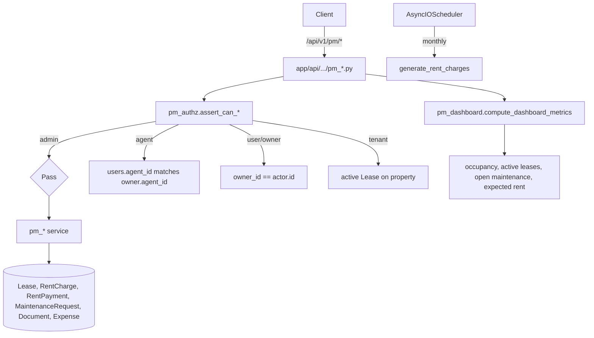

# Property Management

Active contributors: Saksham, Ravi

The Property Management (PM) module is the landlord and relationship-manager surface of 360 Ghar. It manages the full lifecycle of managed properties: leases, rent collection, maintenance requests, documents, inspections, expenses, reports, tenants, rental applications, and RM assignments. Every PM operation flows through a central authorisation layer that enforces owner, agent (RM), tenant, and admin scopes.

## Directory layout

```
app/api/api_v1/endpoints/
├── pm_properties.py       # managed property list, get, dashboard summary
├── pm_leases.py           # lease CRUD, terminate, list
├── pm_rent.py             # generate charges, record payment, due list, history
├── pm_maintenance.py      # maintenance request CRUD, status updates
├── pm_documents.py        # document upload, list, delete
├── pm_inspections.py      # move_in/move_out/routine inspections
├── pm_expenses.py         # expense tracking by category
├── pm_tenants.py          # tenant list, status transitions
├── pm_applications.py     # rental applications + forms
├── pm_assignments.py      # RM (agent) → owner assignments
├── pm_dashboard.py        # portfolio dashboard metrics
└── pm_reports.py          # financial and occupancy reports
app/services/
├── pm_authz.py            # central authorisation layer (assert_can_*)
├── pm_properties.py       # managed property service
├── pm_leases.py           # lease service
├── pm_rent.py             # rent charge generation + payment recording
├── pm_maintenance.py      # maintenance requests + work orders
├── pm_documents.py        # document storage
├── pm_inspections.py      # inspection checklists
├── pm_expenses.py         # expense CRUD
├── pm_tenants.py          # tenant lifecycle
├── pm_applications.py     # rental applications
├── pm_assignments.py      # RM assignments
├── pm_dashboard.py        # dashboard aggregation
└── pm_reports.py          # report generation
app/models/
├── pm_leases.py           # Lease, RentalApplication, RentalApplicationForm
├── pm_finance.py          # RentCharge, RentPayment, Expense
├── pm_maintenance.py      # MaintenanceRequest, WorkOrder
└── pm_documents.py        # Document, InspectionChecklist
```

## Key abstractions

| Abstraction | File | Role |
|---|---|---|
| `assert_can_manage_owner_portfolio` | `app/services/pm_authz.py` | Owner-scope check: admin passes, agent must own the assignment, user must be self |
| `assert_can_access_property` | `app/services/pm_authz.py` | Property-scope check with optional tenant lease lookup |
| `assert_can_access_lease` | `app/services/pm_authz.py` | Lease-scope check resolving tenant, owner, and RM |
| `can_access_booking` | `app/services/pm_authz.py` | Booking-scope check for stays overlap |
| `_get_actor_role` | `app/services/pm_authz.py` | Normalises `UserRole` from model or schema |
| `create_lease` | `app/services/pm_leases.py` | Validates dates, prevents duplicate active leases, persists. REST, MCP tool_ops, the admin agent tool and the AI owner tool all call it |
| `generate_rent_charges` | `app/services/pm_rent.py` | Idempotent monthly charge generation for active leases |
| `record_rent_payment` | `app/services/pm_rent.py` | Records `RentPayment`, updates `RentCharge.status` |
| `create_maintenance_request` | `app/services/pm_maintenance.py` | Tenant or owner creates request, optional lease link |

## How it works

Every PM call starts in `pm_authz.py`. The actor is resolved through `_get_actor_role` (handling both `UserRole` enum columns and string schemas) and routed to one of four scope assertions. Admins pass everywhere. Agents must have `agent_id` linked to the owner's `users.agent_id` column (the RM assignment). Owners act on their own portfolio. Tenants are allowed only when `allow_tenant=True` and they hold an active lease on the property. On a lease, `terminate`, `renew`, `upload-signed` and rent charge generation are owner-side: a tenant on the lease gets 403. Tenants read their own data with `as_tenant=true` on `GET /pm/leases`, `GET /pm/inspections`, `GET /pm/documents`, `GET /pm/rent/charges` and `GET /pm/rent/payments`. The flag is refused for agents and admins (403). Without it, the list shows the caller's own portfolio.



Lease creation enforces a single occupying lease per property: `create_lease` queries for `Lease.property_id == property_id` with an occupying status (`active` or `expiring_soon`) and raises `BadRequestException` if one exists. Lease status transitions go through `draft → pending_signature → active → expiring_soon → expired` (or `terminated` / `renewed`), with `termination_date` and `termination_reason` captured on termination.

Rent collection is idempotent. `generate_rent_charges` accepts a `start_month` and `months` count (1-24), resolves the active-lease scope for the actor, and upserts `RentCharge` rows keyed by `(lease_id, billing_month)`. `record_rent_payment` inserts a `RentPayment`, then recomputes the linked `RentCharge.status` (`pending`, `partial`, `paid`, `overdue`, `waived`) from the sum of payments. Late fees use `late_fee_amount` or `late_fee_percentage` after `grace_period_days` (default 5). Rent amounts, settled totals and balances are `Decimal` in the service layer (`money()` in `app/services/pm/rent_rules.py`). A float becomes a JSON number only at the `Money` schema boundary. A charge with no balance left reads as `paid` on every read, whatever the stored status. The MCP and agent payment tool (`record_lease_rent_payment`) settles the oldest unpaid charge with a balance (`pending`, `partial` or `overdue`, stored overdue included). The `status=overdue` filter matches a charge only when it still has a balance. The `pending` and `partial` filters use the same read-time rule: a charge past its grace period is overdue, and a repaid charge is paid.

A daily job (`app/services/pm_scheduler.py`, 00:30 in the scheduler timezone) runs `app/services/pm/lifecycle.py`. It marks open charges past their grace period as `overdue`, assesses the late fee once, and moves leases by end date: inside 30 days to `expiring_soon`, after the end date to `expired`. A transaction-scoped advisory lock keeps one run at a time. Reads also derive `overdue` from the due date and grace period, so a late run does not hide overdue charges. A fixed late fee wins over a percentage. Overdue, grace and fee rules are pure functions in `app/services/pm/rent_rules.py`. `lifecycle.pending_late_fee` is the one function that says which fee a charge gets today (unpaid, past grace, a balance before the fee, no stored fee, then `late_fee`). The daily job, the payment path (`record_rent_payment` and `settle_rent_payment` count the pending fee in the balance they check) and the MCP and agent rent-due reads (`app/services/pm/rent_due.py`, `tenant_rent_dues`) call it, so a fee shown before the job runs equals the fee the job stores. Reads never write the fee. The REST charge list and the dashboard totals show the stored fee only.

Tenant payments are claims. A tenant request creates a `RentPayment` with `status = pending` and leaves the charge status unchanged. An owner, agent or admin request creates a `settled` payment, which counts toward the balance. An owner, agent or admin confirms a pending claim with `POST /pm/rent/payments/{id}/settle`. The settle step re-checks the balance and then updates the charge. `DELETE /pm/rent/payments/{id}` removes a pending claim: the tenant withdraws its own claim, or an owner, agent or admin rejects it. Settled payments cannot be deleted. A pending claim never changed a total, so removing it changes none.

Lease create accepts only `draft`, `pending_signature` and `active`. The ended states come from renew, terminate and the daily job. Unset `payment_due_day` and `grace_period_days` take the managed property values on every create path. A grace period of 0 stays 0.

A property has at most one occupying lease, where occupying means `active` or `expiring_soon`. A tenant keeps access to the property and can submit maintenance while its lease is occupying (`pm_authz` uses the same set). The owner, agent and admin rent-due tools read unpaid `RentCharge` rows through `list_rent_charge_page` (`app/services/pm/rent_due.py`), with the same overdue and late-fee rules as the daily job. Owner contact on PM property responses is shown to the owner and admins only (`mask_owner_contact`). Lease create (when the new status is `active`) and renew (when it makes the new lease active) refuse a second occupying lease with 400. The partial unique index `uq_leases_property_active` covers the same set (migration `20261014005020`).

Tenant contact fields (`full_name`, `phone`, `email`) on `GET /pm/tenants` and `GET /pm/tenants/{tenant_user_id}` come from the lease the owner typed (`tenant_name`, `tenant_phone`, `tenant_email`). The user account is not read. An owner can link any user id to a lease, so reading the account would expose that user's details. The detail returns 404 unless a lease in the caller's scope links the tenant.

Documents are private Cloudinary uploads. A PDF is stored under the `raw` resource type. `file_url` is a signed delivery URL. It is signed with the resource type that Cloudinary stored, read from the stored URL. The signed URL does not expire.

Legacy public URLs (decision, explicit exception). Documents uploaded before the private rule keep their stored public URL. A permitted viewer receives that URL, but the URL itself is public, so anyone who holds it can open the file. Re-uploading these rows to private storage is the follow-up. Until then, treat these rows as public.

Maintenance requests support the full workflow `open → in_review → work_order_created → resolved → closed`, with linked `WorkOrder` rows carrying `WorkOrderStatus`. Tenants can create requests against properties they lease; owners and RMs manage them. Documents, inspections (move_in/move_out/routine), and expenses are scoped to the same property/lease authorisation.

## Integration points

- **Auth dependencies**: PM endpoints use `get_current_active_user`, `get_current_agent`, and `get_current_admin` from `app/api/api_v1/dependencies/auth.py`.
- **Notifications**: rent due, maintenance status, lease termination, and document approval events flow through [notifications](notifications.md) via `dispatch_notification_to_user`.
- **MCP servers**: the [MCP servers](mcp-servers.md) admin server exposes `agent_*` PM tools; the user server exposes `owner_*` and `tenant_*` PM tools. Shared logic lives in `app/mcp/tool_ops/` (leases, rent, maintenance, dashboard) and `app/mcp/chatgpt/pm_*` modules.
- **AI agent**: the [AI agent](ai-agent.md) registers PM tools for owners, tenants, agents, and admins via `app/services/ai_agent/tools/owner.py` and `tenant.py`.
- **Storage**: documents are private Cloudinary assets (`type=authenticated`). `store_private_document` uploads them. `viewer_file_url` returns a signed URL from the shared `CloudinaryService.private_delivery_url` helper, and only for viewers the document is shared with. An agent gets the URL only for an owner assigned to that agent. Older public uploads keep their stored URL (see the legacy exception above).

## Entry points for modification

New PM operations must go through `pm_authz` — never query `Lease` or `MaintenanceRequest` directly without an `assert_can_access_*` call. A write that stores a referenced id (document, lease, request, agent) must call `assert_owned_reference` (404 unknown, 403 foreign) or `assert_assignable_agent`. New rent charge fields belong in `generate_rent_charges` and the `RentCharge` model; the payment application logic in `record_rent_payment` must be updated to recompute `RentCharge.status`. Status enums live in `app/models/enums.py` and any new value requires a migration plus an enum update in CLAUDE.md.

## Key source files

| File | Purpose |
|---|---|
| `app/services/pm_authz.py` | Central authorisation (260 lines) |
| `app/services/pm_leases.py` | Lease service (280 lines) |
| `app/services/pm_rent.py` | Rent charges + payments (343 lines) |
| `app/services/pm_maintenance.py` | Maintenance + work orders (217 lines) |
| `app/services/pm_dashboard.py` | Dashboard metrics (9.9 KB) |
| `app/services/pm_reports.py` | Financial and occupancy reports |
| `app/services/pm_applications.py` | Rental applications (9 KB) |
| `app/services/pm_properties.py` | Managed property service (8.9 KB) |
| `app/services/pm_documents.py` | Document storage |
| `app/services/pm_inspections.py` | Inspection checklists |
| `app/services/pm_expenses.py` | Expense tracking |
| `app/services/pm_tenants.py` | Tenant lifecycle |
| `app/services/pm_assignments.py` | RM assignments |
| `app/api/api_v1/endpoints/pm_*.py` | 12 endpoint modules |
| `app/mcp/tool_ops/{leases,rent,maintenance,dashboard}.py` | Shared MCP logic |
| `app/mcp/chatgpt/pm_*.py` | ChatGPT-specific PM tool wrappers |
