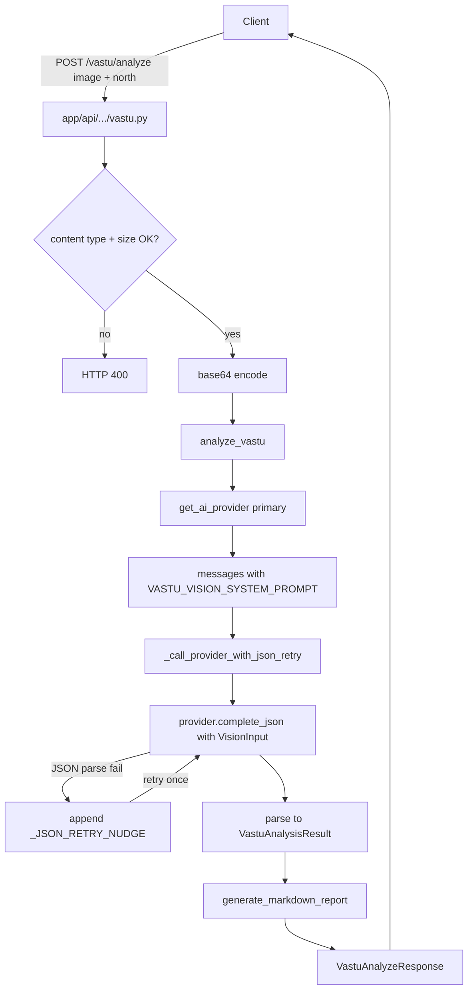

# Vastu

Active contributors: Saksham, Ravi

The Vastu analyzer is a public, AI-powered floor plan compliance checker. Users upload a floor plan image (JPEG, PNG, or WebP up to 5MB), indicate where North points, and receive a comprehensive Vastu Shastra report: an overall score, room-by-room analysis, identified defects with severity, practical remedies, and a markdown report. The analyzer uses the shared AI provider abstraction with automatic JSON-parse retry. The only provider is Agnes AI (`agnes-3.0-flash`), with exponential-backoff retries and no fallback model. The endpoint is rate limited to 5 requests per minute per IP.

## Directory layout

```
app/api/api_v1/endpoints/
└── vastu.py               # POST /vastu/analyze (public, no auth)
app/services/ai/vastu/
├── __init__.py            # re-exports
├── analyzer.py            # analyze_vastu, _call_provider_with_json_retry
├── prompts.py             # VASTU_VISION_SYSTEM_PROMPT, get_user_prompt, generate_markdown_report
└── schemas.py             # VastuAnalyzeRequest, VastuAnalyzeResponse, VastuDefect, VastuRemedy, RoomVastuAnalysis
app/services/ai/
├── base.py                # AIProvider ABC, AIMessage, VisionInput
└── providers/             # AgnesProvider
app/core/constants.py      # DEFAULT_VISION_PROVIDER, VALID_VISION_PROVIDERS
```

## Key abstractions

| Abstraction | File | Role |
|---|---|---|
| `analyze_vastu` | `app/services/ai/vastu/analyzer.py` | Main entry: builds messages, calls provider with JSON retry, returns response |
| `_call_provider_with_json_retry` | `app/services/ai/vastu/analyzer.py` | One retry with corrective nudge on JSON parse failure |
| `VASTU_VISION_SYSTEM_PROMPT` | `app/services/ai/vastu/prompts.py` | Combined layout extraction + Vastu analysis prompt with image validation, direction rules, and remedy guidance |
| `get_user_prompt` | `app/services/ai/vastu/prompts.py` | Builds the user message with north direction and notes |
| `generate_markdown_report` | `app/services/ai/vastu/prompts.py` | Renders the structured analysis into a markdown report |
| `VastuAnalyzeRequest` | `app/services/ai/vastu/schemas.py` | `north_direction`, `notes` (max 1000 chars) |
| `VastuAnalyzeResponse` | `app/services/ai/vastu/schemas.py` | Full response: score, status, rooms, defects, remedies, warnings, markdown report |
| `NorthDirection` | `app/services/ai/vastu/schemas.py` | Enum: `up, down, left, right, unknown` |
| `VastuStatus` | `app/services/ai/vastu/schemas.py` | Enum: `excellent, good, neutral, concerning, problematic` |
| `get_ai_provider` | `app/services/ai/__init__.py` | Factory returning the Agnes AI provider with tenacity retries |

## How it works

The `/vastu/analyze` endpoint accepts a multipart upload: an image file, a `north_direction` form field (default `up`), optional `notes`. It validates the content type against `ALLOWED_TYPES` (`image/jpeg`, `image/png`, `image/webp`) and enforces a 5MB max size. The image bytes are base64-encoded and passed to the AI provider as `VisionInput`.



The system prompt in `prompts.py` is the knowledge core. `VASTU_VISION_SYSTEM_PROMPT` instructs the model to first validate that the image is a 2D architectural floor plan (setting `is_valid_floor_plan` false and `analysis_confidence` to 0.1-0.3 if not), then extract the layout (plot shape, rooms, entrance, special features), then apply direction-based Vastu rules covering entrance (best: North, East, NE; avoid: South, SW), kitchen (ideal: SE Agni corner), master bedroom (ideal: SW), toilets (avoid NE and center/Brahmasthan), living room, and staircase placement. The prompt enumerates core principles, remedy types (placement, color, element, structural), and warning types (not a floor plan, missing rooms, low image quality, ambiguous directions).

Robustness is layered. The AI provider abstraction in `app/services/ai/base.py` wraps HTTP calls with tenacity retries. `_call_provider_with_json_retry` catches `AIProviderError` containing "Failed to parse JSON" and retries once with `_JSON_RETRY_NUDGE` appended to the last user message, instructing the model to return only valid JSON without markdown fences. HTTP 429, 500, 502, 503 and 504 responses and network errors get up to 5 attempts with exponential backoff; waits and `Retry-After` are clamped to 2-30 s. There is no fallback model: when the retries are exhausted the request fails.

The response is a `VastuAnalyzeResponse` containing an overall `score` (1-10), `status` (`VastuStatus`), `analysis_confidence`, `is_valid_floor_plan`, lists of `RoomVastuAnalysis` (per-room status), `VastuDefect` (with `DefectSeverity`), `VastuRemedy` (with `RemedyType`), `AnalysisWarning` (with `AnalysisWarningType` and `AnalysisWarningSeverity`), a parsed `FloorPlanAnalysis`, and the full `markdown_report` rendered by `generate_markdown_report`.

## Integration points

- **AI providers**: vastu uses `get_ai_provider` from `app/services/ai/` with the Agnes AI provider, sharing the same abstraction as [tour AI](virtual-tours.md) and other vision features.
- **Constants**: `DEFAULT_VISION_PROVIDER` and `VALID_VISION_PROVIDERS` in `app/core/constants.py` (Agnes only).
- **Auth**: the endpoint is public — no `get_current_user` dependency. An `EndpointRateLimiter` allows 5 requests per minute per client IP, on top of the global 500 req/min per-IP window.
- **Storage**: vastu does not persist uploaded images or analysis results; it is a stateless request-response service.

## Entry points for modification

Vastu rules and prompt engineering live in `app/services/ai/vastu/prompts.py` — extend `VASTU_VISION_SYSTEM_PROMPT` to add rules or remedy types. Response shape changes require updating the Pydantic schemas in `schemas.py` and the markdown renderer in `generate_markdown_report`. The provider is implemented in `app/services/ai/providers/agnes.py`.

## Key source files

| File | Purpose |
|---|---|
| `app/api/api_v1/endpoints/vastu.py` | Public analyze endpoint (151 lines) |
| `app/services/ai/vastu/analyzer.py` | Main analysis logic (532 lines) |
| `app/services/ai/vastu/prompts.py` | System prompt + knowledge base + markdown report (330 lines) |
| `app/services/ai/vastu/schemas.py` | Request/response Pydantic schemas (230 lines) |
| `app/services/ai/base.py` | AIProvider ABC, AIMessage, VisionInput |
| `app/services/ai/providers/` | AgnesProvider |
| `app/core/constants.py` | Vision provider defaults |
