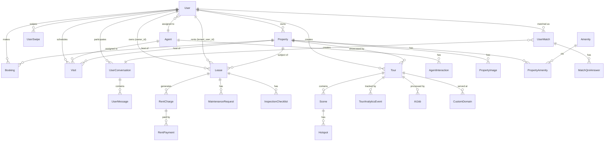

# Data models

The 360Ghar backend has 91 ORM tables across 20 model files, plus 50+ enums in `app/models/enums.py`. This page maps the model inventory, the relationships between key entities, and the conventions that hold it all together.

Active contributors: Saksham, Ravi

## Model files

| File | Tables |
|---|---|
| `app/models/users.py` | `User`, `UserSearchHistory`, `UserSwipe` |
| `app/models/agents.py` | `Agent`, `AgentInteraction` |
| `app/models/properties.py` | `Property`, `PropertyImage`, `Amenity`, `PropertyAmenity`, `Visit` |
| `app/models/bookings.py` | `Booking` |
| `app/models/core.py` | `BugReport`, `Page`, `AppVersion`, `FAQ` |
| `app/models/blogs.py` | `BlogPost`, `BlogCategory`, `BlogTag`, `BlogPostCategory`, `BlogPostTag` |
| `app/models/content.py` | `ContentBlock`, `Locality`, `GeneratedImage` |
| `app/models/social.py` | `UserMatch`, `UserConversation`, `UserMessage`, `UserBlock`, `UserReport`, `AppCatalog`, `MatchQnAAnswer`, `FlatmateProfileViewEvent`, `FlatmateSuperLikeUsage` |
| `app/models/tours.py` | `Tour`, `Scene`, `Hotspot`, `TourAnalyticsEvent`, `AIJob`, `MediaFile`, `TourLocation`, `FloorPlan`, `CustomDomain`, `TourLike` |
| `app/models/pm_leases.py` | `Lease` |
| `app/models/pm_tenants.py` | `RentalApplication`, `RentalApplicationForm` |
| `app/models/pm_finance.py` | `RentCharge`, `RentPayment`, `Expense` |
| `app/models/pm_maintenance.py` | `MaintenanceRequest` |
| `app/models/pm_documents.py` | `Document` |
| `app/models/pm_inspections.py` | `InspectionChecklist` |
| `app/models/ai_conversations.py` | `AIConversation`, `AIConversationMessage` |
| `app/models/data_hub.py` | `BankAuction`, `CircleRate`, `CourtAuction`, `GazetteNotification`, `JamabandiCache`, `ReraProject`, `ReraComplaint`, `ZoningData`, `ColonyApproval`, `NeighbourhoodScore`, `BankRate`, `AuctionAlert`, `ScraperRun`, `SourceDocument`, `DataHubEvidenceAssertion`, `DataHubEntityRevision`, `ReraProjectProfile`, `ReraLandUsage`, `ReraProjectCost`, `ReraQuarterlyExpenditure`, `ReraProjectDocument`, `ReraStatutoryApproval`, `ReraProjectFacility`, `ReraProjectNoc`, `ReraProjectPerson`, `ReraProjectBankAccount`, `ReraProjectUnitConfig`, `ReraProjectSpecification`, `Developer`, `DeveloperScore`, `ProjectPriceHistory`, `MicroMarket`, `ProjectWatchlist`, `MarketPulseSnapshot` |

## Enums

`app/models/enums.py` (563 lines) defines 50+ string enums, all inheriting from `(str, Enum)`. They are stored as `SQLEnum` columns with DB-level `CHECK` constraints. Notable families:

- **Property**: `PropertyType`, `PropertyPurpose`, `PropertyStatus`, `ImageCategory`, `ManagedPropertyStatus`
- **Booking/Visit**: `BookingStatus`, `PaymentStatus`, `VisitStatus`, `VisitContext`
- **Flatmates/Social**: `FlatmatesMode`, `FlatmatesProfileStatus`, `SwipeAction`, `SwipeTargetType`, `ConversationSource`, `ConversationStatus`, `UserMatchStatus`, `MessageType`, `ListingGenderPreference`, `ListingSharingType`, `UserReportReason`, `UserReportStatus`, `ListingModerationStatus`, `ModerationAction`, `ReportAction`
- **PM**: `LeaseStatus`, `RentalApplicationStatus`, `ApplicationFieldType`, `TenantStatus`, `RentChargeStatus`, `ExpenseCategory`, `MaintenanceCategory`, `MaintenanceUrgency`, `MaintenanceRequestStatus`, `WorkOrderStatus`, `DocumentType`, `InspectionType`
- **Tours**: `TourStatus`, `TourVisibility`, `HotspotType`, `AIJobStatus`, `AIJobType` (`analyze_scene`, `analyze_scenes`, `generate_description`, `generate_descriptions`, `generate_tour`, `optimize_tour`, `spatial_connect`, `analyze_floor_plan`, `suggest_hotspots`, `suggest_tour_hotspots`, `panorama_stitch`), `CustomDomainVerificationStatus`, `CustomDomainSSLStatus`
- **Data Hub**: `ScraperStatus`, `AuctionSource`, `GazetteType`, `ComplaintNature`
- **Identity**: `UserRole`, `AuthMethod`, `AgentType`, `ExperienceLevel`, `AgentInteractionType`

The `PG_FLATMATE_TYPES` constant `{PropertyType.pg, PropertyType.flatmate}` marks property types routed through the Flatmates module.

## Entity relationship diagram

## Conventions

- **Base class**: all models inherit from `app.core.database.Base`.
- **Primary keys**: integer auto-incrementing for most tables; UUID strings for tour-related tables (`Tour`, `Scene`, `Hotspot`, `AIJob`, etc.) via `generate_uuid()`.
- **Timestamps**: `created_at` with `server_default=func.now()`, `updated_at` with `onupdate=func.now()`. Both `DateTime(timezone=True)`.
- **Foreign keys**: `ON DELETE CASCADE` for ownership edges (user -> property -> visit). `ON DELETE SET NULL` for soft edges (agent assigned to a visit, tenant user on a lease). `ON DELETE RESTRICT` (default) where referential integrity must block deletion.
- **Enums**: `SQLEnum` columns with DB-level `CHECK` constraints. Some columns (e.g. `Visit.visit_context`) are stored as `String` with a CHECK constraint rather than `SQLEnum` for forward compatibility, typed via the enum at the Python layer.
- **Geospatial**: `Geography(Point, 4326)` from GeoAlchemy2 for the `Property` location. SQLite compile shims in `app/models/properties.py` make `Base.metadata.create_all` work in tests.
- **Full-text search**: a `tsvector` column `__ts_vector__` on `properties`, with indexes created by migrations.
- **Vector embeddings**: a separate `property_embeddings` table (pgvector) rather than a column on `properties`, synced by `app/vector/`.

## Seed data flag

The `is_seed_data` boolean column (default `false`, `server_default=text("false")`) exists on `users`, `agents`, and `properties`. Child tables do not have their own flag - they inherit "seedness" through FK joins to their parent. The `seed_data/02_clear_data.py` script uses this to scope deletions. See [background/pitfalls.md](../background/pitfalls.md).

## Migrations

SQL migrations live in `supabase/migrations/`. They are applied via `supabase db push` or `supabase db reset`. Lightweight DDL that cannot go through the Supabase CLI (enum value additions, column adds) is applied at startup by the lifespan - see [deployment.md](../deployment.md).

## Data Hub provenance

- `SourceDocument` stores authority/title, canonical source locator, jurisdiction, document type/language, license/reuse terms, dates, fetch/check times, content hash, and an optional restricted artifact reference. Source HTML/PDF/text is not stored in this table.
- `DataHubEvidenceAssertion` stores only allowlisted normalized values and structural page/table/row/column locators. Status is constrained to `unreviewed`, `accepted`, `rejected`, or `superseded`; method is constrained to `scrape`, `manual`, `ocr`, or `derived`. Reviewer IDs are private `users.id` references.
- `DataHubEntityRevision` stores an allowlisted normalized snapshot, SHA-256, changed fields, run/source references, and a stable per-entity revision number. A database trigger rejects updates/deletes; unchanged snapshots do not create revisions.
- Both assertions and revisions enforce exactly one typed FK to `rera_projects`, `zoning_data`, or `colony_approvals`. Historical target rows keep `last_checked_at` and `last_successful_run_id` null until checked.

## RERA project intelligence

One filing page per project (`view_project/project_preview_open/{portal_project_id}`) supplies these tables. Collection tables are replaced wholesale only after a filing parses in full, so a failed parse cannot leave a half-written filing. Every table carries a nullable `source_document_id` citing the filing it came from.

| Table | Holds |
|---|---|
| `rera_project_profiles` | 1:1 REP-I scalars: licensed land, land area, proposed/permissible FAR, towers, floors, units, units per acre, RERA received, construction start and proposed completion dates, launch and current price per sq ft, latitude/longitude, derived `stage` |
| `rera_land_usage` | Land-usage split, one row per particular, with area in sq m and acres plus share percentage |
| `rera_project_costs` | 1:1 cost breakdown: land, construction, infrastructure, other, total. The filing states lakhs; every stored amount is in rupees |
| `rera_quarterly_expenditure` | Seven-year quarterly expenditure per `category` (apartment or infrastructure), year, quarter, and particular. Only rows carrying all four quarters are stored |
| `rera_project_documents` | Uploaded documents, keyed by `ordinal` (position across both document tables), with upload date and view URL |
| `rera_statutory_approvals` | 1:1 LOI and licence numbers/dates, electric load, water/storm-water/sewerage availability, and a `plan_approvals` JSONB map of the plan-approval booleans |
| `rera_project_facilities` | Declared facility with its filed cost and status |
| `rera_project_nocs` | NOC row: facility, provider agency, approval state, reference |
| `rera_project_people` | Promoter-side people by `role` (chairman, managing director, director, authorised representative, licensee). **Only `pan_last4` is stored**; the rest of the identifier is discarded on ingest. Contact details are never serialized publicly |
| `rera_project_bank_accounts` | Designated collection account. Stored for reconciliation; `account_number` is excluded from every public response |
| `rera_project_unit_configs` | Apartment type with carpet/built-up/super built-up areas, carpet efficiency, unit count, towers, parkings, and filed price. Keyed by `ordinal` because one type can appear at two carpet areas |
| `rera_project_specifications` | Specification line with `scope` (`project` or `unit`), `unit_type` (`all` for project-wide), key, and value |

New first-class entities alongside them:

| Table | Holds |
|---|---|
| `developers` | One row per promoter slug: name, legal name, logo, website, CIN, summary, dossier markdown, founded year, listed flag, headquarters, geographies, plus `last_checked_at`/`last_successful_run_id` |
| `developer_scores` | 1:1 with a developer: the five pillar scores, weighted `total_score`, project/delivered/under-construction/complaint counts, and `computed_at` |
| `project_price_history` | One price point per project, quarter, unit type, and `source`. `filing` and `launch` points are filed figures; `derived` points are computed and marked as such |
| `micro_markets` | Named sub-market inside a city, unique on `(city, slug)`. `rera_projects.micro_market_id` points at it, and that link is what the read side scopes its statistics by |
| `project_watchlist` | A user's saved project with notes and `alert_prefs`, unique on `(user_id, rera_project_id)` |
| `market_pulse_snapshots` | One city's daily reading, unique on `(city, captured_on)`. Rows are the history; nothing is overwritten |

`project_watchlist`, `rera_project_people`, and `rera_project_bank_accounts` enable row level security with no policy, so PostgREST clients read no rows directly. The backend connects as the table owner and is unaffected.

`rera_projects` gained three things for this work. `slug` is the public URL key, unique via `idx_rera_projects_slug`; Postgres allows repeated NULLs in a unique index, so rows written before the column existed keep a null slug until a filing pass backfills it. `idx_rera_projects_portal_project_id` is a **partial** unique index on `raw_data ->> 'portal_project_id'`, and it is the conflict target for the portal-id scan. The key is the portal id rather than `rera_number` because a filing page states only the portal's pre-registration id and never the registration number; the index is partial so rows from other sources, which carry no portal id, stay unconstrained. Both indexes are declared on the model as well as in the migration, and `verify_schema_drift.py` checks unique indexes including partial ones — expression indexes are skipped on both sides, so the two cannot disagree about them.

`micro_market_id` is a nullable FK to `micro_markets` (`ON DELETE SET NULL`, indexed). It is what a micro-market's project count and average rate are scoped by. Scoping by `district` instead gave every micro-market in one district identical numbers under a different name. The value is written by `MicroMarketScraper` from the project's own filed location, and it is `NULL` when that address names no readable locality — the invariant is that the link always equals the derivation, so a refusal clears the link rather than leaving a stale one.
